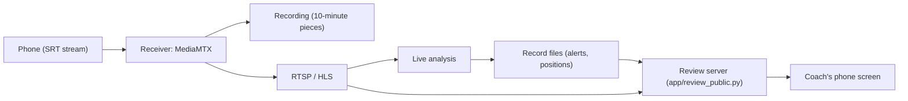

[한국어](README.md) | English | [日本語](README.ja.md)

# amateur-football-analytics

This project analyzes an amateur football match filmed with a single phone, in real time, on a home computer. The coach's phone shows the score, the match clock, alerts, player positions and a half-time report. It chains person detection (YOLO), tracking (ByteTrack), pitch calibration (homography), team separation (shirt colour) and tactical metrics (defensive line, spacing, space occupation) into one pipeline.

It is a research prototype. Every number comes with its source file and sample size, and results that no human has checked are not stated as fact. Experiment records are in the wiki (not included in the public copy) (written in Korean).

## 1. What it does

| Feature | In one line |
|---|---|
| Match setup screen (`/setup`) | Guides a phone-only setup in time order: start a new match, check the video, check the pitch lines, pick the team colour, start the analysis, confirm the attack direction. |
| Bench screen (`/bench`) | The coach sees the scoreboard, the latest alert, earlier alerts, a player-position map and the video on one screen. |
| Event marking (`/tag`) | Match clock, score, half buttons and event buttons such as shots and goals on one screen. One person can run a match with this screen alone. |
| Live video (`/live`) | A view-only screen of the incoming stream. |
| Half-time report (`/halftime`) | Sums up the first half from the first-half start mark and shows our team's shape and a group of opponent findings, mostly as pictures. |
| Match replay (`/replay`) | Builds a match list from the recording folders and jumps to the video position of each marked event. |
| Post-match review | People check results and add labels on the alert judgement page (`/alerts`), shot marks (`/shots`), the video report (`/report`) and missed-player marking (`/train`). |

## 2. Structure



MediaMTX receives the SRT stream from the phone and splits it in two. One branch is saved in 10-minute pieces by `scripts/record_stream_loop.ps1` without re-encoding. The other goes over RTSP to the live analysis (`scripts/run_live_feedback.py`). The analysis appends alerts and positions, one line at a time, to files under `alerts/<session>/` in the store, and the review server reads those files and shows them on the phone. The live video screen is converted by the server from the receiver's stream.

| Folder | Role |
|---|---|
| `app/` | Core modules: the review server (`review_public.py`), screen routes, calibration, tracking, team separation, alert rules |
| `scripts/` | Command-line tools: live analysis, recording, reports, training and evaluation, GPU guard (`gpu_guard.py`), `.ps1` operations scripts |
| `web/` | Phone screens (HTML, JS, CSS) and hls.js in `web/vendor/` |
| `tests/` | pytest tests |
| the wiki (not included in the public copy) | Current state and experiment records. Read the wiki (not included in the public copy) before work and update it afterwards |
| `configs/` | The MediaMTX config template (`mediamtx-srt-local.yml`) |

## 3. Requirements

| Item | Details |
|---|---|
| Operating system | Windows 11. The operations scripts are PowerShell. |
| Python and virtual environment | Verified with Python 3.14.3. Create a virtual environment, install `requirements.txt` (fastapi, uvicorn, opencv-python, numpy, pydantic, ultralytics, pytest, httpx, lap) and, for GPU use, a CUDA build of PyTorch (the wiki (not included in the public copy)). |
| GPU and memory | The verified machine has an RTX 5070 (12 GB graphics memory) and 32 GB RAM. One GPU job gets a budget of 8 GB graphics and 12 GB RAM, and that much must be free at start (the wiki (not included in the public copy)). `/setup` refuses to start the analysis below 4 GB RAM or 3 GB graphics memory free. |
| ffmpeg | Used for recording (`-Ffmpeg` of `record_stream_loop.ps1`), live video conversion, `ffprobe` in the replay, and clip cutting (`--ffmpeg`). Point to the executable with a parameter or setting. |
| MediaMTX | Not in the repository (`mediamtx/` is in `.gitignore`). Get it from its own project and place it at `<repository path>\mediamtx\mediamtx.exe`. The code looks there and stops with "MediaMTX binary missing; see README" if it is absent. To use an approved copy, set `FOOTBALL_SRT_APPROVED_BINARY=1`, which points to the sibling folder `football-coach-server\mediamtx\`. Pass the SRT passphrase only through the environment variable `FOOTBALL_SRT_PASSPHRASE` (32 to 64 characters of letters, digits, `_`, `-`) and never write it to a file. Set the recording folder with the absolute path `FOOTBALL_RECORD_DIR`. The config template is loopback only and is not an internet configuration. |
| Model weights | `*.pt` files are blocked by `.gitignore` and are not in the repository. The default detector `yolo11n.pt`, the weights fine-tuned on our own footage and the team classifier live outside the repository (the `work` folder). Some weights were trained on AI Hub data and are for research and testing only. Human labels and experiment outputs are also kept outside the repository. |

## 4. Getting started

Run the tests with the virtual environment's Python (the baseline is 1184 passed, 1 skipped):

```powershell
uv venv --python 3.14
uv pip install --python .venv\Scripts\python.exe -r requirements.txt
.venv\Scripts\python.exe -m pytest -q
```

Start the review server locally. The default is `127.0.0.1:8443`; change it with `FOOTBALL_REVIEW_BIND` and `FOOTBALL_REVIEW_PORT`. The address in the browser must match `FOOTBALL_REVIEW_ORIGIN`.

```powershell
$env:FOOTBALL_REVIEW_DIR = '<review store folder>'
$env:FOOTBALL_REVIEW_ORIGIN = 'http://127.0.0.1:8443'
.venv\Scripts\python.exe -m app.review_public
# open <server address>/start in a browser
```

Feed a recording to the analysis as if it were a stream. `--realtime` plays the file at real-time speed, and the results pile up in `<review store folder>\alerts\<session>\`, so they show on `/bench` and `/halftime` of the server above. Use the calibration file (`<calibration file>`) and camera name (one of `cam1`, `cam3`, `cam4`) that fit the pitch and camera position of that footage.

```powershell
.venv\Scripts\python.exe scripts\run_live_feedback.py <recording file> <calibration file> cam4 `
  --direction 1 --realtime --device 0 `
  --store <review store folder> --session test-run-01 `
  --positions <review store folder>\alerts\test-run-01\positions.jsonl
```

Always wrap GPU training and evaluation in `scripts/gpu_guard.py --name <experiment name> -- python ...`. To test the real SRT path, `scripts/local_playlist_sender.py` (`--ffmpeg`, `--playlist`, `--output`) sends a playlist of recordings to a loopback SRT address. The server API and settings are described in the wiki (not included in the public copy) (in Korean).

## 5. Match-day flow

The receiver and the recording cannot be started from the web, so start them on the computer beforehand (`scripts/start_match_day.ps1`; its default paths are fixed to one computer and must be adapted). Everything after that is done on the phone at `/setup`.

| Stage | What to press |
|---|---|
| 30 minutes before (warm-up) | The "킥오프 30분 전" (30 minutes before kickoff) group of `/setup`: "새 경기 시작" (start new match), check the video, check the pitch lines ("맞음", fits), "팀 색 사진 만들기" (make team colour photos), "이 묶음이 우리 팀" (this group is our team), "분석 미리 시작" (start analysis early). |
| Just before kickoff | If our team count is 6 or more, press "팀 색 그대로 사용" (keep the team colour); if fewer, "팀 색 다시 찍기" (retake the team colour), and "이전 팀 색으로 되돌리기" (go back to the previous team colour) to undo it. Then confirm the direction with "← 왼쪽으로 공격" (attack left) or "오른쪽으로 공격 →" (attack right). |
| Kickoff | Press the large "전반 시작" (first half start), then move to `/tag` (event marking) or `/bench` (coach). |
| End of first half | Press "전반 끝 · 보고서 만들기" (first half over, make report) on the lower row of `/tag`, then open `/halftime`. |
| Start of second half | Press "후반 시작 · 공격 방향 바꿈" (second half start, switch attack direction) on the lower row of `/tag`. |
| End of match | Press "후반 종료" (second half end) on `/tag`. Afterwards, watch `/replay` and cut the halves with `scripts/cut_halves_from_tags.py`. |

The Korean button labels are verbatim from `web/setup.js`, `web/tag.js` and `web/watch-banner.js`. During a match, do not run another review server or tests on the same computer.

## 6. Screens and routes

| Route | Description |
|---|---|
| `/start` (`/`) | List of screens and guidance by role |
| `/setup` | Match setup in three groups: warm-up, just before kickoff, kickoff |
| `/bench` | Coach bench screen |
| `/tag` | Event marking, score, half buttons |
| `/live` | Full-size video only |
| `/watch` | Live monitoring. A red band and "분석 다시 시작" (restart analysis) appear when the analysis stops |
| `/halftime` | Half-time report (a first-half or second-half choice appears once the second half has started) |
| `/replay` | Replay of past matches |
| `/team-select` | Pick our team colour (older way; `/setup` uses the same API) |
| `/alerts` | Alert judgement and label sessions |
| `/shots` | Shot marking |
| `/report` | Video report |
| `/train` | Training-scene check and missed-player marking |

The stream health page (`/stream`) is served by a separate small server (`scripts/run_stream_health.py`). The full route table is the wiki (not included in the public copy).

## 7. Known limitations

- Team colour: the new team-separation options were verified, switched on, in one match with green and red bibs (30-minute stream simulation: our team averaged 8.00 players, 12 or more players in 0.30% of frames). They failed on two matches with other shirt colours (10 minutes of recording each) (the wiki (not included in the public copy)).
- Colourless shirts: when the hue gap is under 50 degrees or the chroma is under 17.97, the new separation switches itself off and the default reading is used. The wiki has no verification record for striped shirts. The threshold of 6 own players is a provisional value that was not set by testing.
- Ball tracking is suspended. An attempt to infer goals from position records alone failed, so shots and goals depend on human marks (`/tag`).
- Player identification (names, numbers) is suspended. Players are about 48 pixels tall, too small to read numbers (the wiki (not included in the public copy)).
- The review server has no authentication. Anyone who knows the address can start or stop the analysis and watch recordings. The four-character confirmation in `/setup` is not a password; it only prevents mistaken presses. Do not leave the server on a public network as it is.
- Delay: in a loopback simulation of 7 conditions, the median from the sender to the end of the analyzer was 0.97 to 2.35 s, excluding the time for an alert condition to be met (the wiki (not included in the public copy)). The bench screen polls once per second, and the live video is 960 px wide at 8 frames per second.
- Real-world validation: a simulation that republished a recording to the receiver passed (recovery in 12.4 s after a 20 s outage, one trial), but analysis over a real phone on 5G and the screens on real phone browsers have no record in the wiki yet.
- Pitch calibration is needed for each pitch and camera position and must be redone when the framing changes. Most numbers come from one or two matches and must be rechecked on other pitches.

## 8. Development rules in brief

- Read the wiki (not included in the public copy) before work and update the relevant page and the index afterwards. If the wiki and the source disagree, the source is right.
- Human-judged labels are the ground truth. Model output and automatic labels are stored separately and never mixed.
- Run GPU jobs one at a time through `scripts/gpu_guard.py`. No GPU experiments from 2 hours before a match until it ends.
- Fix the pass criteria before looking at results, and consider swapping a model only when it improves on a test of human-drawn boxes.
- On match day, do not change the stream, recording, live analysis or server code.
- Pushes, restarts of the production server and deleting worktrees need the repository owner's approval. See [`CLAUDE.md`](CLAUDE.md) and the wiki (not included in the public copy) for details (both in Korean).

## 9. Data and licences

This repository is licensed under AGPL-3.0-or-later. The full text is in [`LICENSE`](LICENSE). Copyright (C) the project authors. The table below summarizes the wiki (not included in the public copy) and is not legal advice.

| Item | Terms and our use |
|---|---|
| This repository | AGPL-3.0-or-later (`LICENSE`) |
| Ultralytics YOLO | The installed package metadata says AGPL-3.0. Serving other people over a network may create obligations, so this must be decided before turning it into a service. |
| hls.js 1.6.5 | Marked Apache-2.0, served unmodified as `web/vendor/hls.min.js` (`web/vendor/README.md`). |
| AI Hub football data | Used only for local research training after approval. Commercial use is unconfirmed, and models trained on it are for research and testing. |
| SoccerNet, SoccerTrack | Used only for evaluation and testing; weights are not connected to operation. |
| Other public datasets | Terms unconfirmed or rights to the source video unclear, so they are not used for training now. |

Match video shows players and spectators, so video and names are not sent to outside services.
