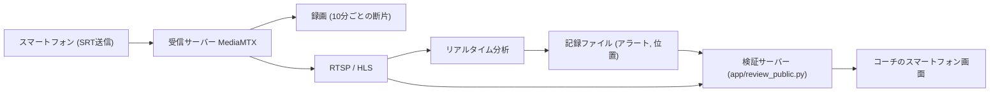

[한국어](README.md) | [English](README.en.md) | 日本語

# amateur-football-analytics

スマートフォン1台で撮影したアマチュアサッカーの試合を、自宅のコンピューターでリアルタイムに分析し、コーチのスマートフォンにスコア、試合時計、アラート、選手の位置、ハーフタイムレポートを表示するプロジェクトです。人の検出(YOLO)、追跡(ByteTrack)、ピッチの校正(ホモグラフィ)、チームの判別(ユニフォームの色)、戦術指標(守備ライン、間隔、空間の占有)を一つの流れにまとめています。

研究用の試作品です。数値には根拠ファイルとサンプル数を付け、人が確認していない結果を事実として断定しません。実験記録は ウィキ(公開版には含まれません)(韓国語)にあります。

## 1. 何をするか

| 機能 | 一行説明 |
|---|---|
| 試合準備画面 (`/setup`) | スマートフォンだけで、新しい試合の開始、映像の確認、ピッチラインの確認、チームカラーの選択、分析の開始、攻撃方向の確定を時間順に案内します。 |
| ベンチ画面 (`/bench`) | コーチがスコアボード、最新のアラート、過去のアラート、選手位置のマップ、映像を一つの画面で見ます。 |
| 場面マーク (`/tag`) | 試合時計、スコア、前後半のボタン、シュートやゴールなどの場面ボタンを一つにまとめた画面です。一人で運用するときはこの画面だけで足ります。 |
| ライブ映像 (`/live`) | 受信中の映像を見るだけの画面です。 |
| ハーフタイムレポート (`/halftime`) | 前半開始のマークから前半終了までを集計し、自チームの形と相手チームのまとめを図中心で示します。 |
| 過去の試合のリプレイ (`/replay`) | 録画フォルダーから試合一覧を作り、マークした場面の時刻へ映像を移動します。 |
| 試合後の検証 | アラート判定(`/alerts`)、シュートのマーク(`/shots`)、映像レポート(`/report`)、見逃した選手のマーク(`/train`)などで、人が結果を確認してラベルを付けます。 |

## 2. 構成



スマートフォンがSRTで送った映像をMediaMTXが受け取り、二つに分けます。一方は `scripts/record_stream_loop.ps1` が再エンコードせずに10分ごとの断片として保存し、もう一方はRTSPでリアルタイム分析(`scripts/run_live_feedback.py`)に入ります。分析はアラートと位置をストア内の `alerts/<セッション>/` 以下のファイルに1行ずつ書き、検証サーバーがそのファイルを読んでスマートフォンの画面に表示します。ライブ映像の画面は、サーバーが受信サーバーの映像を変換して配信します。

| フォルダー | 役割 |
|---|---|
| `app/` | 検証サーバー(`review_public.py`)、画面のルート、校正、追跡、チーム判別、アラート規則などの中核モジュール |
| `scripts/` | コマンドラインツール: リアルタイム分析、録画、レポート、学習と評価、GPU監視(`gpu_guard.py`)、運用用の `.ps1` |
| `web/` | スマートフォン画面(HTML、JS、CSS)と `web/vendor/` の hls.js |
| `tests/` | pytest のテスト |
| ウィキ(公開版には含まれません) | 現在の状態と実験記録。作業前に ウィキ(公開版には含まれません) を読み、終わったら更新します |
| `configs/` | MediaMTX の設定テンプレート(`mediamtx-srt-local.yml`) |

## 3. 必要なもの

| 項目 | 内容 |
|---|---|
| オペレーティングシステム | Windows 11。運用スクリプトは PowerShell です。 |
| Python と仮想環境 | Python 3.14.3 で確認しています。仮想環境を作り、`requirements.txt`(fastapi、uvicorn、opencv-python、numpy、pydantic、ultralytics、pytest、httpx、lap)をインストールし、GPUを使う場合は CUDA 対応の PyTorch を加えます(ウィキ(公開版には含まれません))。 |
| GPU とメモリ | 確認したコンピューターは RTX 5070(グラフィックメモリ 12 GB)、メインメモリ 32 GB です。GPUジョブ1件の予算はグラフィック 8 GB、メイン 12 GB で、開始時にそれだけ空いている必要があります(ウィキ(公開版には含まれません))。`/setup` は、メインメモリの空きが 4 GB、またはグラフィックメモリの空きが 3 GB を下回ると分析の開始を拒否します。 |
| ffmpeg | 録画(`record_stream_loop.ps1` の `-Ffmpeg`)、ライブ映像の変換、リプレイの `ffprobe`、場面の切り出し(`--ffmpeg`)に使います。実行ファイルの場所はパラメーターか設定で指定します。 |
| MediaMTX | リポジトリには入れません(`.gitignore` の `mediamtx/`)。別プロジェクトから入手し、`<リポジトリのパス>\mediamtx\mediamtx.exe` に置きます。コードはこの場所を探し、なければ "MediaMTX binary missing; see README" で停止します。承認済みのコピーを使うには `FOOTBALL_SRT_APPROVED_BINARY=1` を設定し、隣のフォルダー `football-coach-server\mediamtx\` を指します。SRTのパスフレーズは環境変数 `FOOTBALL_SRT_PASSPHRASE`(英数字と `_`、`-` の32~64文字)でのみ渡し、ファイルには書きません。録画フォルダーは絶対パスの `FOOTBALL_RECORD_DIR` で決めます。設定テンプレートはループバック専用で、インターネット向けの設定ではありません。 |
| モデルの重み | `*.pt` は `.gitignore` で除外しているため、リポジトリにはありません。既定の検出器 `yolo11n.pt`、自前の映像でファインチューニングした重み、チーム分類器はリポジトリの外(`work` フォルダー)に置きます。一部の重みは AI Hub のデータで学習しており、研究とテストにのみ使います。人が付けたラベルと実験の成果物もリポジトリの外に置きます。 |

## 4. 始めるには

仮想環境の Python でテストを実行します(基準値は 1184 passed、1 skipped です)。

```powershell
uv venv --python 3.14
uv pip install --python .venv\Scripts\python.exe -r requirements.txt
.venv\Scripts\python.exe -m pytest -q
```

検証サーバーをローカルで起動します。既定は `127.0.0.1:8443` で、`FOOTBALL_REVIEW_BIND` と `FOOTBALL_REVIEW_PORT` で変更します。ブラウザーのアドレスは `FOOTBALL_REVIEW_ORIGIN` と一致させる必要があります。

```powershell
$env:FOOTBALL_REVIEW_DIR = '<検証ストアのフォルダー>'
$env:FOOTBALL_REVIEW_ORIGIN = 'http://127.0.0.1:8443'
.venv\Scripts\python.exe -m app.review_public
# ブラウザーで <サーバーのアドレス>/start を開きます
```

録画ファイルを配信のように分析へ流します。`--realtime` がファイルを実時間の速さで流し、結果は `<検証ストアのフォルダー>\alerts\<セッション>\` にたまって、上のサーバーの `/bench` と `/halftime` に表示されます。校正ファイル(`<校正ファイル>`)とカメラ名(`cam1`、`cam3`、`cam4` のいずれか)は、その映像のピッチとカメラ位置に合うものを使います。

```powershell
.venv\Scripts\python.exe scripts\run_live_feedback.py <録画ファイル> <校正ファイル> cam4 `
  --direction 1 --realtime --device 0 `
  --store <検証ストアのフォルダー> --session test-run-01 `
  --positions <検証ストアのフォルダー>\alerts\test-run-01\positions.jsonl
```

GPUを使う学習と評価は、必ず `scripts/gpu_guard.py --name <実験名> -- python ...` で包んで実行します。実際のSRT経路で試すには、`scripts/local_playlist_sender.py`(`--ffmpeg`、`--playlist`、`--output`)が録画の一覧をループバックのSRTアドレスへ送ります。サーバーAPIと設定は ウィキ(公開版には含まれません)(韓国語)にあります。

## 5. 試合当日の流れ

受信サーバーと録画はウェブからは起動できないため、事前にコンピューターで起動します(`scripts/start_match_day.ps1`。既定のパスが1台のコンピューターに固定されているため、環境に合わせて直す必要があります)。それ以降はスマートフォンの `/setup` で進めます。

| 段階 | 押すもの |
|---|---|
| キックオフ30分前(ウォームアップ) | `/setup` の「킥오프 30분 전」(キックオフ30分前)のグループ: 「새 경기 시작」(新しい試合を開始)、映像の確認、ピッチラインの確認(「맞음」、合っている)、「팀 색 사진 만들기」(チームカラーの写真を作る)、「이 묶음이 우리 팀」(このグループが自チーム)、「분석 미리 시작」(分析を先に開始)。 |
| キックオフ直前 | 自チームの人数が6以上なら「팀 색 그대로 사용」(チームカラーをそのまま使う)、少なければ「팀 색 다시 찍기」(チームカラーを撮り直す)、元に戻すには「이전 팀 색으로 되돌리기」(前のチームカラーに戻す)。続けて「← 왼쪽으로 공격」(左へ攻撃)または「오른쪽으로 공격 →」(右へ攻撃)で方向を確定します。 |
| キックオフ | 大きな「전반 시작」(前半開始)を押し、`/tag`(場面マーク)または `/bench`(コーチ)へ移ります。 |
| 前半終了 | `/tag` の下の行の「전반 끝 · 보고서 만들기」(前半終了・レポート作成)を押し、`/halftime` を見ます。 |
| 後半開始 | `/tag` の下の行の「후반 시작 · 공격 방향 바꿈」(後半開始・攻撃方向を切り替え)を押します。 |
| 試合終了 | `/tag` の「후반 종료」(後半終了)を押します。その後は `/replay` で見返し、`scripts/cut_halves_from_tags.py` で前半と後半の映像を切り出します。 |

韓国語のボタン表記は `web/setup.js`、`web/tag.js`、`web/watch-banner.js` の原文のままです。試合中は、同じコンピューターで別の検証サーバーやテストを動かしません。

## 6. 画面とルート

| ルート | 説明 |
|---|---|
| `/start` (`/`) | 画面の一覧と役割別の案内 |
| `/setup` | 試合準備。ウォームアップ、キックオフ直前、キックオフの3グループ |
| `/bench` | コーチのベンチ画面 |
| `/tag` | 場面マーク、スコア、前後半ボタン |
| `/live` | 映像だけを大きく表示 |
| `/watch` | ライブ監視。分析が止まると赤い帯と「분석 다시 시작」(分析を再開始)が出ます |
| `/halftime` | ハーフタイムレポート(後半が始まると前半と後半の選択が出ます) |
| `/replay` | 過去の試合のリプレイ |
| `/team-select` | 自チームの色を選ぶ(従来の方式で、`/setup` が同じAPIを使います) |
| `/alerts` | アラートの判定とラベルのセッション |
| `/shots` | シュートのマーク |
| `/report` | 映像レポート |
| `/train` | 学習場面の確認と見逃した選手のマーク |

配信状態の診断(`/stream`)は別の小さなサーバー(`scripts/run_stream_health.py`)が出します。ルートの全一覧は ウィキ(公開版には含まれません) にあります。

## 7. 既知の制限

- チームカラー: 新しいチーム判別オプションは、緑のビブスと赤のビブスの1試合でのみ、オンにした状態で検証しました(30分のストリーム模擬試験で、自チームの平均は8.00人、12人以上の割合は0.30%)。別のユニフォーム色の2試合(各10分の録画)では不合格でした(ウィキ(公開版には含まれません))。
- 無彩色のユニフォーム: 色相の差が50度未満、または彩度が17.97未満のとき、新しい判別は自動でオフになり、既定の判別で動作します。縞模様のユニフォームについての検証記録はウィキに見つかりませんでした。自チーム6人という基準は、テストで決めていない暫定値です。
- ボールの追跡は中断しています。位置記録だけでゴールを推定する試みは不合格だったため、シュートとゴールは人のマーク(`/tag`)に頼ります。
- 選手の識別(名前、背番号)は中断しています。選手の身長は約48ピクセルで、番号を読むには小さすぎます(ウィキ(公開版には含まれません))。
- 検証サーバーには認証がありません。アドレスを知っている人は、分析の開始と停止、録画の閲覧ができます。`/setup` の4文字の確認はパスワードではなく、誤操作を防ぐためのものです。公開ネットワークにそのまま置かないでください。
- 遅延: ループバックの模擬試験7条件で、送信から分析器の終了までの中央値は0.97~2.35秒でした。アラート条件が満たされるまでの時間は含みません(ウィキ(公開版には含まれません))。ベンチ画面は1秒ごとに読み込み、ライブ映像は幅960ピクセル、毎秒8フレームです。
- 実環境での検証: 録画を受信サーバーへ再配信した模擬試験は合格しましたが(20秒の途切れから12.4秒で回復、1回)、実際のスマートフォンと5G回線の上での分析、および実機のスマートフォンのブラウザーでの画面確認は、ウィキにはまだ記録がありません。
- ピッチの校正はピッチとカメラ位置ごとに必要で、構図が変わったらやり直します。数値の多くは1~2試合で測った値なので、別のピッチで再確認が必要です。

## 8. 開発ルールの要約

- 作業前に ウィキ(公開版には含まれません) を読み、終わったら該当ページと目次を更新します。ウィキと原本が食い違う場合は原本が正しいものとします。
- 人が判定したラベルが正解です。モデルの出力と自動ラベルは別に保管し、混ぜません。
- GPUジョブは一度に一つだけ、`scripts/gpu_guard.py` 経由で実行します。試合の2時間前から終了まではGPU実験をしません。
- 合格基準は結果を見る前に固定し、モデルの入れ替えは、人が描いた枠のテストで改善した場合にのみ候補とします。
- 試合当日は、配信、録画、リアルタイム分析、サーバーのコードを変更しません。
- プッシュ、本番サーバーの再起動、ワークツリーの削除は、リポジトリの持ち主の承認を得て行います。詳しくは [`CLAUDE.md`](CLAUDE.md) と ウィキ(公開版には含まれません)(いずれも韓国語)を参照してください。

## 9. データとライセンス

このリポジトリのライセンスは AGPL-3.0-or-later です。全文は [`LICENSE`](LICENSE) にあります。Copyright (C) the project authors. 下の表は ウィキ(公開版には含まれません) の要約であり、法的助言ではありません。

| 対象 | 利用条件と私たちの使い方 |
|---|---|
| このリポジトリ | AGPL-3.0-or-later (`LICENSE`) |
| Ultralytics YOLO | インストールされたパッケージのメタデータは AGPL-3.0 です。ネットワーク経由で他の人にサービスを提供すると義務が生じる可能性があるため、サービス化の前に方針を決める必要があります。 |
| hls.js 1.6.5 | Apache-2.0 と表記されており、無改変で `web/vendor/hls.min.js` として提供しています(`web/vendor/README.md`)。 |
| AI Hub のサッカーデータ | 承認後、ローカルでの研究用学習にのみ使います。商用利用は未確認で、このデータで学習したモデルは研究とテスト用です。 |
| SoccerNet、SoccerTrack | 評価とテストにのみ使い、重みは運用に接続していません。 |
| その他の公開データ | 条件が未確認、または元映像の権利が不明確なため、現在は学習に使っていません。 |

試合映像には選手と観客が映っているため、映像と名前を外部サービスへ送りません。
