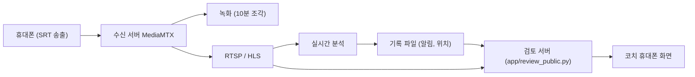

한국어 | [English](README.en.md) | [日本語](README.ja.md)

# amateur-football-analytics

휴대폰 한 대로 찍은 아마추어 축구 경기를 집의 컴퓨터에서 실시간으로 분석하고, 코치의 휴대폰에 점수와 시계, 알림, 선수 위치, 하프타임 보고서를 보여 주는 프로젝트입니다. 선수 검출(YOLO), 추적(ByteTrack), 경기장 보정(호모그래피), 팀 구분(옷 색), 전술 지표(수비 줄, 간격, 공간 점유)를 하나의 흐름으로 묶었습니다.

연구용 시제품입니다. 수치에는 근거 파일과 표본 크기를 붙이고, 사람이 확인하지 않은 결과는 사실로 단정하지 않습니다. 실험 기록은 위키(공개본에는 포함되지 않음)에 있습니다.

## 1. 무엇을 하는가

| 기능 | 한 줄 설명 |
|---|---|
| 경기 준비 화면 (`/setup`) | 휴대폰만으로 새 경기 시작, 영상 확인, 경기장 선 확인, 팀 색 고르기, 분석 시작, 공격 방향 확정을 시간순으로 안내합니다. |
| 벤치 화면 (`/bench`) | 코치가 점수판, 가장 최근 알림, 이전 알림, 선수 위치 지도, 영상을 한 화면에서 봅니다. |
| 장면 표시 (`/tag`) | 경기 시계, 점수, 반 단추, 슛과 골 같은 장면 단추를 한 화면에 모았습니다. 혼자 운영할 때는 이 화면 하나로 충분합니다. |
| 라이브 영상 (`/live`) | 수신한 송출 영상을 보기만 하는 화면입니다. |
| 하프타임 보고서 (`/halftime`) | 전반 시작 표시부터 전반 끝까지를 모아 우리 팀 모양과 상대 팀 묶음을 그림 중심으로 보여 줍니다. |
| 지난 경기 다시보기 (`/replay`) | 녹화 폴더에서 경기 목록을 만들고, 표시한 장면의 시각으로 영상을 옮겨 줍니다. |
| 경기 뒤 검토 | 알림 판정(`/alerts`), 슛 표시(`/shots`), 영상 보고서(`/report`), 놓친 선수 표시(`/train`) 등으로 사람이 결과를 확인하고 라벨을 답니다. |

## 2. 구조



휴대폰이 SRT로 보낸 영상을 MediaMTX가 받아 두 갈래로 나눕니다. 한쪽은 `scripts/record_stream_loop.ps1`이 다시 인코딩하지 않고 10분 조각으로 저장하고, 다른 쪽은 RTSP로 실시간 분석(`scripts/run_live_feedback.py`)에 들어갑니다. 분석은 알림과 위치를 저장소의 `alerts/<세션>/` 아래 파일에 한 줄씩 쓰고, 검토 서버가 그 파일을 읽어 휴대폰 화면에 보여 줍니다. 라이브 영상 화면은 수신 서버의 영상을 서버가 변환해 내보냅니다.

| 폴더 | 역할 |
|---|---|
| `app/` | 검토 서버(`review_public.py`), 화면 경로, 보정, 추적, 팀 구분, 알림 규칙 등 핵심 모듈 |
| `scripts/` | 명령줄 도구: 실시간 분석, 녹화, 보고서, 학습과 평가, GPU 감시(`gpu_guard.py`), 운영용 `.ps1` |
| `web/` | 휴대폰 화면(HTML, JS, CSS)과 `web/vendor/`의 hls.js |
| `tests/` | pytest 시험 |
| 위키(공개본에는 포함되지 않음) | 현재 상태와 실험 기록. 작업 전에 위키(공개본에는 포함되지 않음)를 읽고 끝나면 갱신합니다 |
| `configs/` | MediaMTX 설정 틀(`mediamtx-srt-local.yml`) |

## 3. 필요한 것

| 항목 | 내용 |
|---|---|
| 운영 체제 | Windows 11. 운영 스크립트가 PowerShell입니다. |
| 파이썬과 가상환경 | Python 3.14.3에서 확인했습니다. 가상환경을 만들어 `requirements.txt`(fastapi, uvicorn, opencv-python, numpy, pydantic, ultralytics, pytest, httpx, lap)를 설치하고, GPU를 쓰려면 CUDA용 PyTorch를 더합니다(위키(공개본에는 포함되지 않음)). |
| GPU와 메모리 | 확인한 컴퓨터는 RTX 5070(그래픽 메모리 12 GB), 일반 메모리 32 GB입니다. GPU 작업 하나의 예산은 그래픽 8 GB, 일반 12 GB이고 시작할 때 그만큼 비어 있어야 합니다(위키(공개본에는 포함되지 않음)). `/setup`은 일반 메모리 4 GB 또는 그래픽 3 GB 미만이면 분석 시작을 거절합니다. |
| ffmpeg | 녹화(`record_stream_loop.ps1`의 `-Ffmpeg`), 라이브 영상 변환, 다시보기의 `ffprobe`, 장면 자르기(`--ffmpeg`)에 씁니다. 실행 파일 위치는 매개변수나 환경 설정으로 지정합니다. |
| MediaMTX | 저장소에 넣지 않습니다(`.gitignore`의 `mediamtx/`). 별도 프로젝트에서 받아 `<저장소 경로>\mediamtx\mediamtx.exe`에 둡니다. 코드가 이 위치를 찾고, 없으면 "MediaMTX binary missing; see README"로 멈춥니다. 승인된 복사본을 쓰려면 `FOOTBALL_SRT_APPROVED_BINARY=1`로 옆 폴더 `football-coach-server\mediamtx\`를 가리킵니다. SRT 암호문은 환경 변수 `FOOTBALL_SRT_PASSPHRASE`(영문, 숫자, `_`, `-` 32~64자)로만 넘기고 파일에 적지 않습니다. 녹화 폴더는 절대 경로 `FOOTBALL_RECORD_DIR`로 정합니다. 설정 틀은 loopback 전용이며 인터넷 설정이 아닙니다. |
| 모델 가중치 | `*.pt`는 `.gitignore`가 막아 저장소에 없습니다. 기본 검출기 `yolo11n.pt`와 우리 영상으로 미세조정한 가중치, 팀 분류기는 저장소 밖(`work` 폴더)에 둡니다. 일부 가중치는 AI Hub 자료로 학습해 연구와 시험용으로만 쓰고, 사람이 단 라벨과 실험 산출물도 저장소 밖에 둡니다. |

## 4. 시작하기

시험 실행(가상환경의 파이썬으로, 기준선은 1184 passed, 1 skipped입니다):

```powershell
uv venv --python 3.14
uv pip install --python .venv\Scripts\python.exe -r requirements.txt
.venv\Scripts\python.exe -m pytest -q
```

검토 서버를 로컬에서 띄웁니다. 기본값은 `127.0.0.1:8443`이고, `FOOTBALL_REVIEW_BIND`와 `FOOTBALL_REVIEW_PORT`로 바꿉니다. 브라우저 주소는 `FOOTBALL_REVIEW_ORIGIN`과 같아야 합니다.

```powershell
$env:FOOTBALL_REVIEW_DIR = '<검토 저장소 폴더>'
$env:FOOTBALL_REVIEW_ORIGIN = 'http://127.0.0.1:8443'
.venv\Scripts\python.exe -m app.review_public
# 브라우저에서 <서버 주소>/start 를 엽니다
```

녹화 파일을 송출처럼 넣어 분석을 돌려 봅니다. `--realtime`이 파일을 실시간 속도로 흘리고, 결과는 `<검토 저장소 폴더>\alerts\<세션>\`에 쌓여 위 서버의 `/bench`와 `/halftime`에 보입니다. 보정 파일(`<보정 파일>`)과 카메라 이름(`cam1`, `cam3`, `cam4` 중 하나)은 그 경기장 구도에 맞는 것을 씁니다.

```powershell
.venv\Scripts\python.exe scripts\run_live_feedback.py <녹화 파일> <보정 파일> cam4 `
  --direction 1 --realtime --device 0 `
  --store <검토 저장소 폴더> --session test-run-01 `
  --positions <검토 저장소 폴더>\alerts\test-run-01\positions.jsonl
```

GPU를 쓰는 학습과 평가는 반드시 `scripts/gpu_guard.py --name <실험 이름> -- python ...`으로 감쌉니다. 실제 SRT 경로로 시험하려면 `scripts/local_playlist_sender.py`(`--ffmpeg`, `--playlist`, `--output`)가 녹화 목록을 loopback SRT 주소로 보냅니다. 서버 API와 설정은 위키(공개본에는 포함되지 않음)에 있습니다.

## 5. 경기 날의 흐름

수신 서버와 녹화는 웹에서 켜지 못하므로 컴퓨터에서 미리 켭니다(`scripts/start_match_day.ps1`, 기본 경로가 한 대의 컴퓨터에 고정돼 있어 환경에 맞게 고쳐야 합니다). 이후는 휴대폰의 `/setup`에서 진행합니다.

| 단계 | 누르는 것 |
|---|---|
| 킥오프 30분 전 (워밍업) | `/setup`의 "킥오프 30분 전" 묶음: "새 경기 시작", 영상 확인, 경기장 선 확인("맞음"), "팀 색 사진 만들기", "이 묶음이 우리 팀", "분석 미리 시작". |
| 킥오프 직전 | 우리 팀 인원이 6 이상이면 "팀 색 그대로 사용", 적으면 "팀 색 다시 찍기"(되돌리려면 "이전 팀 색으로 되돌리기"). 이어서 "← 왼쪽으로 공격" 또는 "오른쪽으로 공격 →"으로 방향을 확정합니다. |
| 킥오프 | 큰 "전반 시작"을 누르고 `/tag`(장면 표시) 또는 `/bench`(코치)로 옮겨 갑니다. |
| 전반 끝 | `/tag` 아래 줄의 "전반 끝 · 보고서 만들기"를 누르고 `/halftime`을 봅니다. |
| 후반 시작 | `/tag` 아래 줄의 "후반 시작 · 공격 방향 바꿈"을 누릅니다. |
| 경기 끝 | `/tag`의 "후반 종료"를 누릅니다. 뒤에 `/replay`로 다시 보고, `scripts/cut_halves_from_tags.py`로 전반과 후반 영상을 자릅니다. |

한국어 단추 문구는 `web/setup.js`, `web/tag.js`, `web/watch-banner.js`의 원문 그대로입니다. 경기 중에는 같은 컴퓨터에서 다른 검토 서버나 시험을 돌리지 않습니다.

## 6. 화면과 경로

| 경로 | 설명 |
|---|---|
| `/start` (`/`) | 화면 목록과 역할별 안내 |
| `/setup` | 경기 준비. 워밍업, 킥오프 직전, 킥오프 세 묶음 |
| `/bench` | 코치 벤치 화면 |
| `/tag` | 장면 표시, 점수, 반 단추 |
| `/live` | 영상만 크게 보기 |
| `/watch` | 라이브 감시. 분석이 멈추면 빨간 띠와 "분석 다시 시작" |
| `/halftime` | 하프타임 보고서(후반 시작 뒤에는 전반과 후반 선택) |
| `/replay` | 지난 경기 다시보기 |
| `/team-select` | 우리 팀 색 고르기(이전 방식, `/setup`이 같은 API를 씁니다) |
| `/alerts` | 알림 판정과 라벨 세션 |
| `/shots` | 슛 표시 |
| `/report` | 영상 보고서 |
| `/train` | 학습 장면 확인과 놓친 선수 표시 |

송출 상태 진단(`/stream`)은 별도의 작은 서버(`scripts/run_stream_health.py`)가 냅니다. 전체 경로 표는 위키(공개본에는 포함되지 않음)에 있습니다.

## 7. 알려진 한계

- 팀 색: 새 팀 판별 옵션은 초록 조끼와 빨간 조끼 한 경기에서만 켜진 채 검증했습니다(30분 스트림 모의 시험, 우리 팀 평균 8.00명, 12명 이상 0.30%). 다른 옷 색의 녹화 10분씩 두 경기에서는 불합격이었습니다(위키(공개본에는 포함되지 않음)).
- 무채색 옷: 색상 차가 50도 미만이거나 채도가 17.97 미만이면 새 판별이 저절로 꺼지고 기본 판독으로 동작합니다. 줄무늬 옷에 대한 검증 기록은 위키에서 찾지 못했습니다. 우리 팀 인원 6명 기준은 시험으로 정하지 않은 임시값입니다.
- 공 추적은 중단 상태입니다. 위치 기록만으로 골을 추정하는 시도는 불합격이었고, 슛과 골은 사람 표시(`/tag`)에 의존합니다.
- 선수 식별(이름, 등번호)은 중단 상태입니다. 번호를 읽기에는 선수 키가 약 48픽셀로 작습니다(위키(공개본에는 포함되지 않음)).
- 검토 서버에 인증이 없습니다. 주소를 아는 사람은 분석을 시작하거나 멈추고 녹화를 볼 수 있습니다. `/setup`의 네 글자 확인은 비밀번호가 아니라 잘못 누름을 막는 장치입니다. 공개 망에 그대로 두지 마세요.
- 지연: 루프백 모의 시험 7개 조건에서 송출부터 분석기 끝까지 중앙값 0.97~2.35초였고, 알림 조건이 채워지는 시간은 포함하지 않습니다(위키(공개본에는 포함되지 않음)). 벤치 화면은 1초마다 읽고, 라이브 영상은 960 폭, 초당 8장입니다.
- 실제 환경 검증: 녹화를 수신 서버에 다시 게시한 모의 시험은 통과했지만(끊김 20초 뒤 12.4초 만에 회복, 1회), 실제 휴대폰과 5G 송출 위의 분석, 그리고 실제 휴대폰 브라우저에서의 화면 확인은 위키 기준으로 아직 없습니다.
- 경기장 보정은 경기장과 카메라 구도마다 필요하고, 구도가 바뀌면 다시 해야 합니다. 수치 대부분은 한두 경기에서 잰 값이라 다른 경기장에서 다시 확인해야 합니다.

## 8. 개발 규칙 요약

- 작업 전에 위키(공개본에는 포함되지 않음)를 읽고 끝나면 해당 페이지와 목차를 갱신합니다. 위키와 원본이 다르면 원본이 맞습니다.
- 사람이 판정한 라벨이 정답입니다. 모델 출력과 자동 라벨은 따로 보관하고 섞지 않습니다.
- GPU 작업은 한 번에 하나, `scripts/gpu_guard.py`로 실행합니다. 경기 2시간 전부터 경기 끝까지 GPU 실험을 하지 않습니다.
- 합격 기준은 결과를 보기 전에 고정하고, 모델 교체는 사람이 그린 상자 시험에서 나아질 때만 후보로 삼습니다.
- 경기 날에는 송출, 녹화, 실시간 분석, 서버 코드를 바꾸지 않습니다.
- 푸시, 운영 서버 재시작, 워크트리 삭제는 저장소 주인의 승인을 받고 합니다. 자세한 것은 [`CLAUDE.md`](CLAUDE.md)와 위키(공개본에는 포함되지 않음)를 보십시오.

## 9. 자료와 라이선스

이 저장소의 라이선스는 AGPL-3.0-or-later입니다. 전문은 [`LICENSE`](LICENSE)에 있습니다. Copyright (C) the project authors. 아래는 위키(공개본에는 포함되지 않음)의 요약이며 법률 자문이 아닙니다.

| 대상 | 이용 조건과 우리 사용 |
|---|---|
| 이 저장소 | AGPL-3.0-or-later (`LICENSE`) |
| Ultralytics YOLO | 설치본 메타데이터는 AGPL-3.0입니다. 네트워크로 다른 사람에게 서비스하면 의무가 생길 수 있어 서비스화 전에 결정해야 합니다. |
| hls.js 1.6.5 | Apache-2.0 표기, 파일을 고치지 않고 `web/vendor/hls.min.js`로 제공합니다(`web/vendor/README.md`). |
| AI Hub 축구 자료 | 승인 뒤 로컬 연구 학습에만 씁니다. 상업 이용은 확인하지 못했고, 이 자료로 학습한 모델은 연구와 시험용입니다. |
| SoccerNet, SoccerTrack | 평가와 시험에만 쓰고 가중치를 운영에 연결하지 않았습니다. |
| 기타 공개 데이터 | 조건 미확인이거나 원본 영상 권리가 불확실해 현재 학습에 쓰지 않습니다. |

경기 영상에는 선수와 관중이 찍혀 있으므로 영상과 이름을 외부 서비스로 보내지 않습니다.
